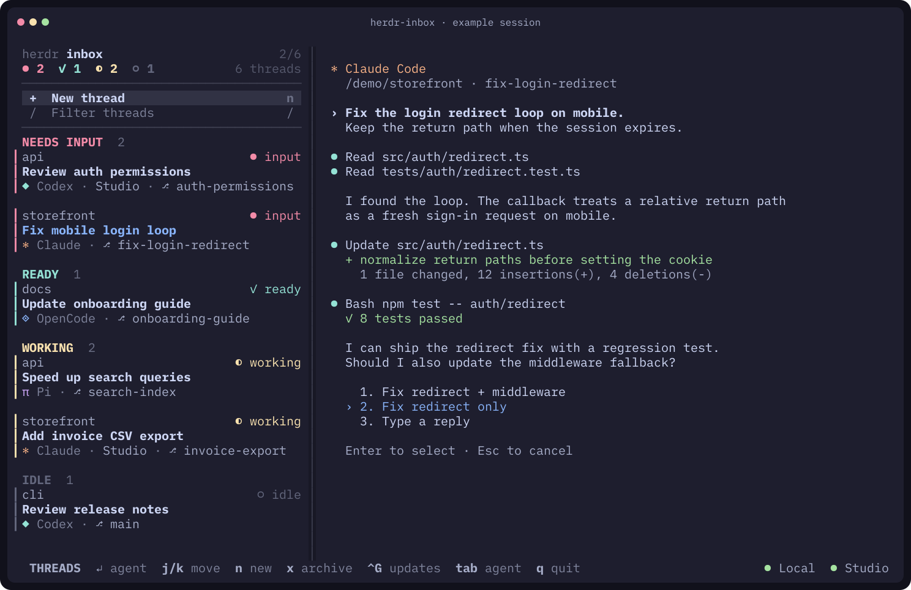
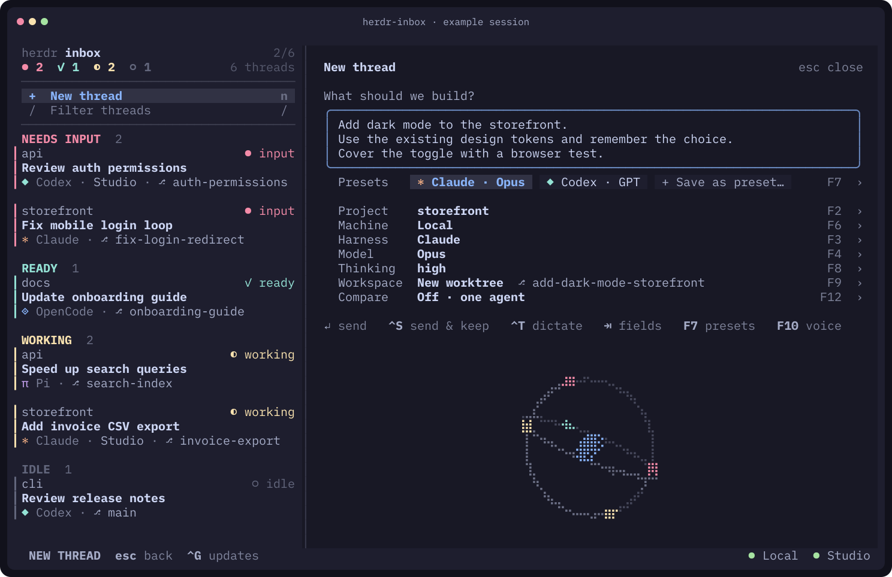

# Herdr Inbox

**Your agents keep coding. You know who needs you next.**

Run Claude Code, Codex, OpenCode and Pi across your projects and machines.
Herdr Inbox puts their threads in one terminal, with agents waiting for your
input and finished tasks at the top. Answer a question, review a result, then
move on while the rest keep working.

Built on [Herdr](https://herdr.dev), with a live, fully interactive agent
terminal beside the list. Launch your next task in a fresh git worktree
without leaving the inbox.

[Install](#install) · [Try your first task](#try-your-first-task) ·
[Star on GitHub](https://github.com/lucasscariot/herdr-inbox)



*An example session. The agent waiting for an answer comes first; finished
tasks are ready to review, and the others keep running.*

## Keep the work moving

- See what needs you next. Threads group themselves into needs input, ready,
  working and idle as agent status changes.
- Browse a discussion with `j` and `k`, then press `Enter` to type directly
  into the agent's live terminal. Reply from the list with `r`.
- Start tasks in separate git worktrees by default. Pick your project,
  machine, agent and model, or reuse a saved preset.
- Give the same task to two or three agents with `F12`. Each gets its own
  worktree so you can compare their approaches.
- Bring your saved SSH machines into the same inbox. Local and remote
  threads share one list, with each machine's connection status in view.
- Dictate with `Ctrl+T`, or paste a screenshot into a local task or reply.
- Type `$` to use any skill installed on the machine, whichever agent runs
  the task.

## Install

You need [Herdr](https://herdr.dev) 0.9.2 or newer and an installed coding
agent CLI. Project and agent discovery requires Python 3.9 or newer,
available as `python3` locally and on any SSH machines you use. Prebuilt
binaries support Linux and macOS on x86_64 and arm64.

```sh
curl -fsSL https://raw.githubusercontent.com/lucasscariot/herdr-inbox/main/install.sh | sh
```

Then open your inbox:

```sh
herdr-inbox                  # the default Herdr session
herdr-inbox --session work   # a named session
```

If no Herdr server is running, Inbox starts one, so the local machine is
ready before you write a task. If that start fails, Inbox says so and offers
to try again. Existing threads in that session appear automatically.

The installer checks the download's SHA-256 and puts `herdr-inbox` in
`~/.local/bin`. Add that directory to your `PATH` if needed, or set
`HERDR_INBOX_INSTALL_DIR` to choose another directory. To update, press
**Ctrl+G** in the thread list or composer, or run the installer again.

Herdr Inbox runs beside plain `herdr` on the same sessions. It uses Herdr's
public interfaces and leaves your Herdr installation alone. It starts a
server only when you ask, and installs an Inbox update only when you confirm.

### Try your first task

1. Press `n` or click **+ New thread**.
2. Pick a project with `F2` and an installed agent with `F3`, or click their
   fields. Choose a model and thinking level if the agent supports them,
   or keep its defaults.
3. Write a task, such as "Add dark mode to the storefront", and press
   `Enter`. Inbox launches it in a new worktree by default.
4. Watch its status change. Select the thread to preview the discussion,
   then press `Enter` to answer a question or review the result.



*Write the task, pick your setup, send. Saved presets make the next launch
a click or a keypress away.*

Inbox looks for projects under `~/Work`, `~/Projects` and `~/goinfre` by
default. If your repositories live elsewhere, set `roots` in
`~/.config/herdr-inbox/config.toml`:

```toml
roots = ["~/code"]
```

Restart Inbox after changing its configuration. See
[configuration](#configuration) for more options. To compare approaches,
press `F12` in the composer and add a second or third agent before sending.

### Build from source

To build from source instead (Rust 1.88 or newer):

```sh
cargo install --locked --git https://github.com/lucasscariot/herdr-inbox
```

### Uninstall

To uninstall, remove the binary and, if you like, what it remembers:

```sh
rm ~/.local/bin/herdr-inbox
rm -rf ~/.config/herdr-inbox ~/.local/state/herdr-inbox ~/.local/share/herdr-inbox
```

## Use

| Where | Key | Action |
| --- | --- | --- |
| Threads | `j` `k` / `↓` `↑` | Move and show the selected discussion |
| | `g` `G` / `Home` `End` | Show the first / last discussion |
| | `PageUp`, `PageDown` | Move by a page of threads |
| | Mouse wheel | Scroll without moving the selection |
| | `Enter`, `o`, click | Focus the selected agent |
| | `n`, click **+ New thread** | Open the composer |
| | `r` | Reply to the agent without opening it |
| | `e` | Send the thread's task again, from the composer. On a failed launch it retries: same task, any preset, in the worktree it already made |
| | `/`, click **Filter threads** | Filter by title, project, branch, harness or machine; `Esc` clears |
| | `x`, `Delete`, `Backspace` twice | Archive: closes the thread's workspace, keeps its worktree on disk. The second press (or `Enter`, `y`) confirms; `Esc` cancels |
| | `d` | Dismiss a failed launch; its task stays in the composer history (`Ctrl+P`) |
| | `Ctrl+T` | Dictate to the thread under the cursor |
| | `F10` | Dictation settings |
| | `Ctrl+G` | Check GitHub releases and update Inbox |
| | `Tab`, `Esc` | Back to the agent |
| | `q`, `Ctrl+C` | Quit |
| Agent | anything | Goes to the agent, including `Ctrl+C` and `Shift+Tab` |
| | `Ctrl+T` | Dictate to the agent |
| | `Tab` | Back to the threads |

Threads are grouped as **needs input**, **ready** (finished, not yet focused),
**working** and **idle**. The most recent change in each group comes first.

Moving through tasks shows each discussion immediately, without Enter.
Keyboard focus stays in the list until you press Enter or Tab, or click the
agent. Previewing a finished task does not mark it seen or move its row;
focusing the agent does.

A small coloured glyph marks each thread's harness before its name: ✻ for
Claude Code, ◆ for Codex, π for Pi and ◈ for OpenCode. Other harnesses get a
neutral ❯ and their own name. The harness name comes before the branch, so a
long branch cannot hide which agent is running. A position counter and a
scroll thumb show where you are in the list.

Below the composer's controls when there is room, and when no thread is open,
the orbit turns: the core is the inbox, each ring a machine, each bead a
thread in its status colour. The core breathes while a thread needs input,
and a ring goes dashed while its machine connects or red when it is
unreachable.

Herdr Inbox reads your Herdr theme at startup: the same built-in themes,
`[theme] name`, and `[theme.custom]` colours from
`$XDG_CONFIG_HOME/herdr/config.toml` or `~/.config/herdr/config.toml`.
`HERDR_CONFIG_PATH` overrides that file, just as it does in Herdr.
Headings, composer hints and thread metadata use the theme's neutral `text` and
`subtext0` colours. The configured `accent` marks focus and selected items,
plus the small orbit core; statuses and harness glyphs keep their own theme
colours. The live agent terminal keeps the agent's original colours.

To change the accent, set it in Herdr's config, not Inbox's:

```toml
[theme.custom]
accent = "#89b4fa"
```

The legacy `[ui] accent` also works; `[theme.custom] accent` takes precedence.

### Updating Inbox

Press **Ctrl+G** in the thread list or composer. From an agent, press Tab
first; Ctrl+G inside an agent still goes to the agent. Updates also work
without a running Herdr server.

The dialog checks GitHub's latest stable release and shows your running
version, the release version and its notes. Arrow keys scroll the notes,
**B** opens that exact release in your browser, and **R** checks again.
Checking never installs anything. Press **Enter** to confirm an available
update, or Escape to return to your draft or thread.

Inbox downloads the binary for this machine, verifies its SHA-256 and version,
then replaces the binary you are running, including a custom install directory.
A failed download or verification leaves the old binary intact. Restart Inbox
after a successful update; your agents keep running. Nothing updates Herdr,
your settings or saved SSH machines. The dialog needs `curl` to check GitHub.
It does not install prereleases, unreleased `main` builds or older versions.

### Starting a thread

Press `n` or click **+ New thread**. Write the task, check the choices under
it, press `Enter` or click **send**. Click in the task to place the cursor,
click a field to open its choices, then click a choice. The mouse wheel moves
through a choice list. The task stays near the top even in a tall window.

Right under the task, the **Presets** strip lists your saved harness, model
and thinking combinations as chips, in your order of preference. A new thread
starts on the first preset. Click a chip, or press `F7` and a digit, to switch
in one move; the chip in use is highlighted. **+ Save as preset…** (or
`Ctrl+D`) saves the current choices under a name.

The composer clears at once and stays open for the next task; the launch runs
in the background and its progress shows under **Launches**.

| Key | Action |
| --- | --- |
| `Enter` | Send |
| `Ctrl+S`, `Ctrl+Enter` | Send and keep the task, to send it again elsewhere |
| `Shift+Enter`, `Alt+Enter` | New line |
| `Tab`, `Shift+Tab` | Move between the task and the choices |
| `F7`, then `1`-`9` | Presets: focus the strip, apply the nth preset |
| `F2` `F6` `F3` `F4` `F8` `F9` | Project, machine, harness, model, thinking, workspace |
| `F3`, then **Auto** | Let the inbox pick the harness with the most usage left |
| `F12` | Compare: send the task to two or three agents at once |
| `Ctrl+T` | Dictate the task |
| `Ctrl+V`, the desktop's paste | Paste a screenshot as `[Image #1]` |
| `$` | Name a skill: `↑` `↓` choose, `Tab` or `Enter` insert, `Esc` keeps a plain `$` |
| `Ctrl+P`, `Ctrl+N` | Previous and next tasks from the history |
| `Ctrl+D` | Save the harness, model and thinking level as a preset |
| `F5` | Rescan projects, model catalogs and usage |
| `Ctrl+G` | Check GitHub releases and update Inbox |
| `Esc` | Close a list, then the composer (the draft stays) |

**Presets.** On the strip (`F7`, or `Tab` from the task), `←` and `→` move
between chips, `Enter` applies one, `1`-`9` applies the nth preset directly,
`PageUp` moves the highlighted preset one place earlier and `PageDown` one
place later, saving the order immediately and keeping that preset highlighted.
`Ctrl+←` and `Ctrl+→` also reorder. The first preset is the one every new
thread starts on. `Ctrl+R` renames and `Delete` removes. A preset whose CLI
is not installed on the chosen machine is shown dimmed and skipped as the
starting preset. After a send, the composer goes back to the first preset;
`Ctrl+S` keeps the task and the chosen preset.

Every list filters as you type: `bgpk` finds `opencode/big-pickle`. A model
the list does not know can still be used: type its id and pick **Use …**.

- **Project** lists the git repositories (and folders with a project manifest)
  found under your roots on every machine; linked worktrees are grouped under
  their repository.
- **Machine** lists the machines that have the project.
- **Harness**, **Model** and **Thinking** come from the agent CLIs installed
  on that machine and their own model lists. Models match both their display
  name and their id. Codex's GPT models offer the reasoning levels reported
  in its `models_cache.json`, including new levels; `CODEX_HOME` is respected.
  Choosing a different model clears an incompatible thinking level. **Default**
  leaves the CLI's settings alone. If no levels are reported, the Thinking row
  says so rather than silently disappearing. `F5` refreshes the catalog.
  OpenCode 2 has no `--model` flag on its interactive command, so the inbox
  creates an OpenCode session with the chosen model through `opencode api`
  and starts OpenCode on it with `--session`.
- **Workspace** is a new git worktree by default, its branch named after the
  task (shown as `⎇ branch`), or one you name, or an existing checkout.
  The name keeps up to four content words of the task's first sentence:
  "Please can you add a CSV export?" launches on `add-csv-export`. Herdr
  creates worktrees under `~/.herdr/worktrees/<repo>/<branch>`.

**Usage and the Auto harness.** The **Usage** row under the choices shows
how much of each subscription is spent, window by window: `✻ Claude 5h 38% ·
week 29%  ·  ◆ Codex week 17%`, with the age of the reading on the right. A
window over 80 % is yellow; a reached limit is red with its reset time. The
**Harness** list (`F3`) starts with **Auto · most usage left**: pick it and the
inbox chooses, at every send, the installed harness whose subscription has the
most headroom before any of its limits (the tightest window counts), keeping
the model and thinking level you last used with that harness. The row reads
`Auto → Codex · 83% left`. Close calls (within five points) keep the harness
in use, so the choice does not flap. Auto is remembered per project and
outranks the first preset there; naming a harness or a preset turns it off.
Without numbers, Auto falls back to your remembered harness and says so.

The numbers come from the CLIs' own channels, never from a provider token:

- **Codex** is asked through its own app server (`codex app-server`,
  `account/rateLimits/read`), which answers in under a second and spends no
  quota; its newest session log is the fallback. Codex "full reset" credits
  show as `· 3 resets`.
- **Claude Code** hands its usage to the status line it runs. Every Claude
  thread the inbox launches gets `--settings` with a small wrapper as its
  status line; the wrapper saves the numbers privately under
  `~/.local/state/herdr-inbox/usage/` and then runs your own `statusLine`
  command, if you have one (project local, project, then user settings, as
  Claude Code orders them), on the same input; your other status line
  options (`padding`, `refreshInterval`…) are kept. Claude numbers appear once an
  inbox-launched Claude thread has had its first reply, and follow the open
  threads; before that the row says `no usage data yet`. Threads started by
  plain `herdr` report too if you make the wrapper your status line in
  `~/.claude/settings.json`:
  `{"statusLine": {"type": "command", "command": "python3 ~/.local/state/herdr-inbox/usage/statusline.py ~/.local/state/herdr-inbox/usage/anthropic.json"}}`.

Usage is read when the composer opens, every five minutes while it is open,
and on `F5`, on every machine that has `claude` or `codex`. Other harnesses
show no usage unless the config maps them to a provider (below).

**Comparing agents.** Off by default, the **Compare** row (`F12`) sends the
same task to two or three agents at once, to compare their results. Add a
preset or an installed harness with its default model; pick it again to drop
it; **Off** goes back to one agent. The composer's own harness, model and
thinking level is the first agent. Every compared agent gets its own new
worktree so they never touch each other's files: the branches share the
task's name and end with the agent's harness and model, shown as
`⎇ fix-login-{claude,codex-gpt-5}`, and a checkout cannot be chosen while
comparing. Each agent appears under **Launches** and in the thread list with
its branch. A comparison is an experiment on one task: the next task goes to
one agent again, and only the first agent's choices are remembered for the
project.

**Screenshots.** Paste an image into the task or a reply (`r`) and it shows
as `[Image #1]`. It is saved under `~/.cache/herdr-inbox/images` (kept 30
days) and reaches the agent the way its own paste would: Claude Code and Codex
attach it, other agents get its path. In an open thread the agent reads the
clipboard itself. Images work for threads on this machine; on a saved SSH
machine the agent would get a path it cannot open. On Linux this needs
`wl-clipboard` (Wayland) or `xclip` (X11).

**Skills.** Type `$` in the task or a reply (`r`) to list the skills
installed on the chosen machine, filtered as you type, and insert one as
`$name`. Inbox finds them where the harnesses keep them: `~/.agents/skills`
first, then `~/.codex/skills` (or `$CODEX_HOME/skills`), `~/.claude/skills`,
`~/.config/opencode/skills`, `~/.pi/agent/skills`, `~/.gemini/skills` and
`~/.copilot/skills`, each a folder with a `SKILL.md`. Harnesses invoke and
look for skills differently, so the task keeps `$name` as you wrote it (Codex
reads that natively), and the agent also gets a short list of each named
skill's `SKILL.md` path at the end of the message. Any agent can read that
file, so a skill installed for one harness works with every other. `$` before
anything that is not an installed skill (`$HOME`, `$5`) stays plain text.
`F5` rescans the skills.

The composer remembers per project which machine, harness and workspace mode
you used, and per machine and harness which model and thinking level, so
switching hosts never carries over another host's model. A remembered machine
that is down (no Herdr server, or unreachable) gives way to one that is up and
has the project, so the composer never opens on a machine it cannot send to.

If an agent stops at a startup dialog (a folder-trust or login prompt), the
thread shows under **needs input**. Answer the dialog in the thread and the
task is sent as soon as the agent is ready.

#### Configuration

`~/.config/herdr-inbox/config.toml`, every key optional (until it exists, the
legacy plugin's `config.json` is read):

```toml
roots = ["~/Work", "~/Projects"]   # where projects are found
depth = 2                          # how deep to look, 0 to 3
branch_prefix = "lucas/"           # prepended to new branch names
default_workspace = "worktree"     # or "checkout"
agent_start_timeout_ms = 45000

[harness_args]                     # extra flags per agent CLI
codex = ["--no-daemon"]

[harness_executables]              # when a CLI has another name
claude = "claude-dev"

[models]                           # model ids to add to a CLI's list
claude = ["claude-opus-5-5"]

[[projects]]                       # repositories outside the roots
path = "/srv/api"
machine = "Mac Studio"

[machines."Mac Studio"]            # per machine: replaces, never merges
harness_args = { codex = ["--no-daemon", "--fast"] }

[usage]                            # subscription usage and the Auto harness
enabled = true                     # false hides the row and the Auto choice
claude_statusline = true           # give Claude threads the reporting status line
providers = { opencode = "anthropic" }  # a CLI on the Claude or ChatGPT plan

[api]                              # prompts from a web page; see below
enabled = false
```

### Dictation

Press `Ctrl+T` to talk, anywhere: the composer's task, an agent's prompt,
a reply, or the thread under the cursor. Press `Ctrl+T` again to type the
words unsent, so you can read them before pressing Enter. Ordinary spaces
type immediately and never start dictation by default.

Hold-to-dictate is optional. Enable it in `~/.config/herdr-inbox/config.toml`:

```toml
[speech]
space_hold = true
```

With this setting, hold Space to talk and let go to type the words unsent.
Herdr Inbox detects a hold from keyboard auto-repeat, so a tapped space
followed by a pause waits about 700 ms initially. The next key types any
waiting spaces before itself. After a hold, the wait adapts to your keyboard's
repeat delay. Omit `space_hold` or set it to `false` for immediate spaces;
Ctrl+T still works.

While the status bar shows `● REC` and the live meter:

| Key | Action |
| --- | --- |
| Let go of space | Stop and type the words, unsent (when holding space) |
| `Enter` | Stop and send: launch the task, send the reply, or prompt the agent |
| `Ctrl+T` | Stop and type the words, unsent |
| `Esc` | Discard |

Nothing you type reaches an agent while the microphone is open. If the words
cannot be delivered (the agent is waiting for an answer, say), the notice
keeps them so you can paste them.

`F10` sets up transcription. Pick a service and paste its key (Groq and
Gemini have free tiers), or build whisper.cpp locally for fully offline
dictation, or give any command that prints a transcript for `{file}`.
Installed `voxtype` or `whisper-cli` with a model are found on their own.
Recording uses `pw-record`, `arecord`, `parecord`, `sox` or `ffmpeg`,
whichever is installed; hosted services are called with `curl`.

`[speech]` in the config can force a backend, pin a language or model, turn
on `space_hold`, or hold keys; `GROQ_API_KEY`, `GEMINI_API_KEY`, `OPENAI_API_KEY`,
`MISTRAL_API_KEY` and `DEEPGRAM_API_KEY` work too.

### Coming from the plugin

Herdr Inbox used to be a Herdr plugin plus a patched Herdr client. It is now
this one program. On first start it copies the plugin's remembered choices,
presets, task history and dictation keys, and reads its `config.json` until a
`config.toml` exists; nothing in the plugin's directories is changed. To move
over:

1. Install with the line above. It replaces the old `herdr-inbox` command.
2. Remove the plugin: `herdr plugin uninstall lucasscariot.herdr-inbox` (or
   `herdr plugin unlink …` for a linked checkout), delete the
   `lucasscariot.herdr-inbox.*` key bindings from `~/.config/herdr/config.toml`,
   then `herdr server reload-config`.
3. Delete the patched client: `rm -r ~/.local/share/herdr-inbox/bin`. A
   whisper.cpp built by the plugin next to it is reused as is.

### Other machines

Every enabled machine you saved in Herdr (`herdr machine add`, listed by
`herdr machine list`) joins the same list. Each remote row names its machine,
and the status bar shows each machine's state: `●` live, `◌` connecting, `✗`
unreachable. Opening a remote thread streams it live over SSH, and typing
reaches it the same way.

Herdr Inbox reaches a machine with your own SSH setup, one shared connection
per host. On the remote side it needs `herdr` on the PATH of a login shell, or
in `~/.local/bin`, `~/.cargo/bin`, Homebrew or mise. A machine that cannot be
reached never blocks the others. Project and agent discovery on that machine
also needs Python 3.9 or newer available as `python3`. Without a local Herdr
server (one that failed to start), the remote threads stay usable, and `s`
tries the local server again.

### Prompts from another device

Inbox can take tasks from a web page, such as a dashboard you open on your
phone, while it is running. It is off until you turn it on, and then it
answers one page and one person only:

```toml
[api]
enabled = true
port = 7777                                      # on 127.0.0.1 only
allowed_origin = "https://dashboard.example.com" # the page that sends tasks
allowed_login = "you@example.com"                # your Tailscale login
```

Inbox listens on `127.0.0.1` alone. Publish it to your tailnet, and only
there, with `tailscale serve`, which adds HTTPS and the caller's login:

```sh
tailscale serve --bg --https=443 http://127.0.0.1:7777
```

The page sends `POST /prompts` with
`{"repository": "owner/name", "prompt": "…"}`. Inbox finds the project whose
`origin` is that GitHub repository on this machine and launches the task
exactly as the composer would on a new thread: a new worktree, the Auto
harness when usage is read (read again first when it is more than five
minutes old), the model and thinking level last used with it,
your branch prefix and harness arguments. The task goes to the history and
shows as a launch. The answer is `202` with the `harness`, `branch` and
`agent` it chose, or an `error`: `404` when there is no checkout (Inbox looks
again, so a fresh clone works on the next try), `409` when another project
has the same name (give one a `name` in `[[projects]]`), `503` while Herdr is
not running or projects are still being found, or when Inbox did not answer
in time, in which case the task is never launched later.

Anything else is refused: another origin, a request without the
`Tailscale-User-Login` header `tailscale serve` adds, or another login. A
request straight to the port from this machine could set that header itself,
so the port is never published any other way.

### When another window has the thread

A Herdr pane takes input from one live client at a time. Opening a thread in
Herdr Inbox takes it over, sized to the inbox's terminal area. If another
client takes it back, the inbox says so, and `Enter` brings it back.

## Develop

```sh
cargo test                   # unit tests and the installer, no Herdr needed
HERDR_E2E=1 cargo test --test e2e   # end to end against a real herdr
```

Release Please maintains a release PR from Conventional Commits on `main`,
updating `Cargo.toml`, `Cargo.lock` and `CHANGELOG.md`. The maintainer merges
that PR to release. The workflow builds and tests all four binaries on
self-hosted runners, uploads their checksums, then publishes the draft release.
Linux releases cross-compile with native Rust and LLVM, then check the target
architecture and version without running the compiler under emulation.
No hand-written version bump or tag push is needed.

[CI and releases](docs/ci.md) covers the Blueprint Linux runners, the native
macOS runner, fork safety and retrying a failed release.

The end-to-end tests start their own Herdr server with every directory in a
temporary folder, so they never touch your sessions. They wait for a successful
API ping before creating workspaces. CI runs them against the Herdr release
pinned in `.github/workflows/ci.yml`; description-only PR edits do not consume
runners or cancel those checks. Each check runs once per push: the release
workflow builds binaries only on PRs that change how they are built.

See [ARCHITECTURE.md](ARCHITECTURE.md) for how the pieces fit together.

## Help more people find Inbox

If Inbox earns a place in your terminal, [give it a GitHub
star](https://github.com/lucasscariot/herdr-inbox). It helps other developers
running several agents find the project.

Have a workflow to share or something slowing you down? [Open an
issue](https://github.com/lucasscariot/herdr-inbox/issues).

## License

[MIT](LICENSE). The built-in theme colours come from Herdr (Apache 2.0).
